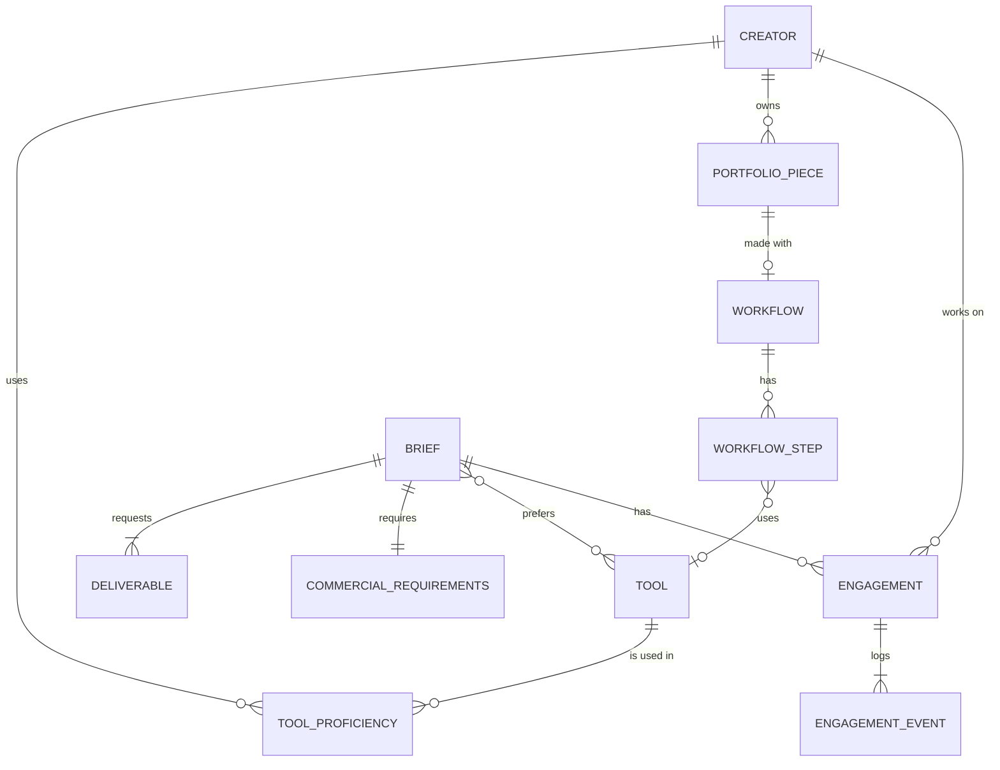

# Data model note

Lumora's model has two sides: **creators** (what they can do, and proof of it) and **briefs** (what a brand needs, and the rights it requires). **Engagements** connect the two. Types live in `src/lib/types.ts`, and Zod mirrors them for user and AI input in `src/lib/schemas.ts`.

## Entities

| Entity | Purpose | Key fields |
|---|---|---|
| **Tool** | Master list of AI and post tools | `id`, `name`, `category` (video, image, audio, 3d, editing, upscale…), `commerciallySafe` |
| **Creator** | A creator profile | `specializations[]`, `skills[]`, `tools: ToolProficiency[]`, `contentTypes[]`, `formats[]`, `styles[]`, pricing, `commercial: CommercialTerms`, `identityVerified`, `portfolio[]` |
| **ToolProficiency** | A creator's use of one tool | `toolId`, `level` 1–5, `yearsUsing`, `verified` |
| **PortfolioPiece** | One work | `contentType`, `aspectRatio`, `durationSec`, `toolIds[]`, `workflow?`, `client?`, `result?`, `clientVerified`, `commercialUseCleared` |
| **Workflow** | How a piece was made | `steps[] {title, toolId?, detail}`, `promptExample?`, `generations`, `hoursSpent`, `postProduction[]` |
| **Brief** | What a brand needs | `objective`, `audience`, `deliverables[]`, `moods[]`, `palette[]`, `requiredSkills[]`, `preferredToolIds[]`, `commercial: CommercialRequirements`, `budget`, `deadline`, `revisionRounds` |
| **Deliverable** | One output in a brief | `contentType`, `quantity`, `aspectRatio`, `durationSec?`, `resolution` |
| **CommercialRequirements** | Rights the brand needs | `usageTypes[]`, `platforms[]`, `territory`, `licenseDuration`, `exclusivity`, `ownership`, `aiDisclosureRequired`, `watermarkFree`, `derivativeRights`, `commerciallySafeToolsOnly` |
| **Engagement** | A creator working on a brief | `status`, `revisionsUsed`, `events[] {at, actor, type, note?}` |

## Tools, skills, formats and commercial fields

| Concept | Creator side (offers) | Brief side (requires) | Used by |
|---|---|---|---|
| Tools | `tools[].toolId` + `level` + `verified` | `preferredToolIds[]`, `commerciallySafeToolsOnly` | Tools filter, match (15, weighted by level), trust (30), commercial-safe rule |
| Skills | `skills[]` (master list of 16) | `requiredSkills[]` | Skills filter (creator must have **all**), match (25) |
| Formats | `formats[]` + piece `aspectRatio` | `deliverables[].aspectRatio` | Format filter, match (10) |
| Content type | `contentTypes[]` + piece `contentType` | `deliverables[].contentType` | Type filter, match (20) |
| Commercial use | `licensesOffered[]`, `ownershipOptions[]`, `exclusivityAvailable[]`, `usageDurations[]`, `aiDisclosure`, `trainingDataStatement` | `usageTypes[]`, `ownership`, `exclusivity`, `licenseDuration`, flags | Match (5), profile terms table |

## Relationships

## Why it's designed this way

- **Workflow is first-class data.** Steps, tools, prompts, generations and hours are structured, so they render as a stepper, count toward trust ("workflow shared" = 3+ steps), and let brands judge process, not just output.
- **Commercial terms are structured on both sides.** Creators *offer* licenses, ownership and exclusivity, and briefs *require* them, so compatibility can be computed and explained instead of discovered in an email thread.
- **Verification is derived, never stored.** Tool verification, shared workflows, client-confirmed work and identity combine into a 0–100 trust score through pure functions, so the score can't drift from the data.
- **One master list per vocabulary.** Skills, tools, moods, platforms and enums live in one constants module that seed data, filters, forms and the AI's allowed values all share. AI output outside that list is dropped.
- **Engagements are an event log.** Status changes go through a state machine with role checks and a revision limit, and each change appends an event, which gives a full audit trail.
